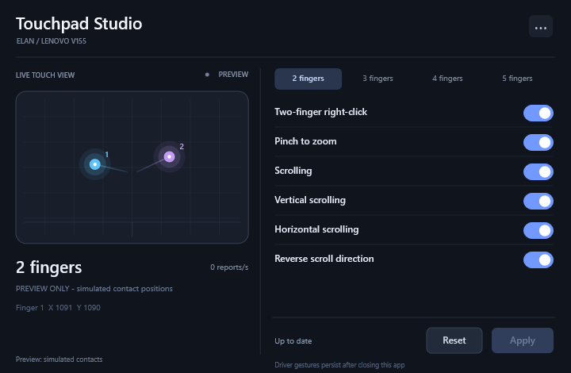

# ELAN Touchpad Settings for Windows 11

A native, portable touchpad settings app for the **Lenovo V155-15API**
with the legacy ELAN driver on Windows 11. The application is called
**Touchpad Studio**.



Independent software, unaffiliated with Lenovo, ELAN or Microsoft. This is
built around one tested driver stack; compatibility with other ELAN laptops
has not been established. It uses the existing driver and does not bundle
or install a replacement driver.

## Download and run

Download the [Windows x64 portable ZIP](releases/v1.1.0/TouchpadStudio-v1.1.0-windows-x64.zip),
extract it into a folder you can write to, and open **TouchpadStudio.exe**.
No installation or administrator access is needed for normal use.

You can also download the [standalone EXE](releases/v1.1.0/TouchpadStudio.exe)
if you do not want the optional Mouse Properties integration.
[SHA-256 checksums](releases/v1.1.0/SHA256SUMS.txt) are included.
The binaries are unsigned; Windows may show a reputation prompt.

## Features

- Compact native C++ interface with live positions and trails for up to
  five contacts. The screenshot above uses labelled simulated contacts.
- Two-finger right-click, pinch zoom, scrolling and scroll direction.
- Driver-backed three- and four-finger tap and directional swipe actions.
- Optional five-finger app shortcuts for desktop, Task view and media.
- **Apply** saves a validated backup, writes supported settings and reloads
  the current session's ELAN Control process when driver settings change.
- **Reset** discards pending edits and rereads saved settings.
- Optional **Touchpad Studio** tab in classic Windows Mouse Properties,
  with install, removal and a read-only registration plan.

Two-, three- and four-finger settings belong to the ELAN driver and persist
when the app closes. Custom five-finger shortcuts require the app to stay
open or minimized. They are disabled initially; no startup entry is added.

## Compatibility

| Component | Tested configuration |
| --- | --- |
| Laptop | Lenovo V155-15API |
| OS | Windows 11 25H2, x64, build 26200.9711 |
| Touchpad | ELAN0628, legacy ELAN stack |
| Driver | 22.4.22.2, 26 March 2020 |
| Live contact API | Installed System32 ETDApi.dll **11.9.4.1** |

Pinch disable/enable and five-contact tracking have been confirmed on the
original laptop. Automated checks cover configuration mappings, backup
serialization and recognizer logic. Physical behaviour of every three-,
four- and five-finger action has not been verified. Legacy Windows 10
choices may behave differently on Windows 11.

See [compatibility and implementation notes](docs/COMPATIBILITY.md).

## Optional Mouse Properties tab

From the extracted ZIP, run:

```powershell
.\Install-Mouse-Properties-Launcher.ps1 -PlanOnly
.\Install-Mouse-Properties-Launcher.ps1
```

Installation prompts for administrator approval for one Windows handler
registration. COM registration targets the initiating Windows user.
Close and reopen Mouse Properties, then select **Touchpad Studio**.
You can open Mouse Properties with `main.cpl`; Windows Settings may also
link to it under additional mouse/touchpad settings, depending on the
Windows version and installed driver.

This adds a launcher tab in classic Mouse Properties. It does not add a
custom section to the modern Settings touchpad page.

Keep the extracted folder in place while registered. Before moving or
deleting it, run:

```powershell
.\Remove-Mouse-Properties-Launcher.ps1
```

The registration backup is kept beside the app and is needed for removal.
See the [user guide](docs/USER-GUIDE.md) for details and troubleshooting.

## Build and contribute

```powershell
.\scripts\Build.ps1 -ZigPath C:\Tools\zig-0.14.1\zig.exe
.\scripts\Test.ps1
.\scripts\Package.ps1
```

See [build instructions](docs/BUILDING.md) for the pinned compiler download,
checksum, tests and packaging. The GUI is C++17 using Win32, Direct2D,
DirectWrite and WIC. Zig provides the C++ compiler; there is no Zig code or
runtime dependency. The native launcher is a separate optional DLL.

Use scoped conventional commits, with every commit-message line at most
72 characters. Source and release binaries are distributed under the
[MIT licence](LICENSE). Vendor driver files are not redistributed.
